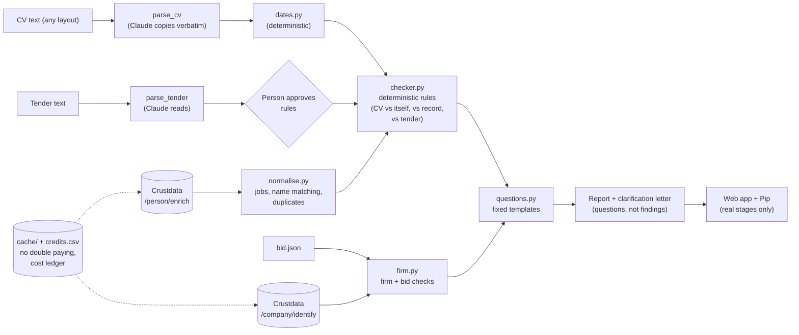

# Tender Bid Audit — The Career Check (theme 1.2) for government tenders

## The service
**Which service:** scrutiny of key-expert CVs in consultancy tenders: checking each expert's claimed years, past
roles, dates and availability before a contract is awarded. The same check applies to hiring CVs (Career Check, theme 1.2).

**Who does it today:** tender evaluation committees, by hand (NHAI, MoRTH, state PWDs, multilateral lenders), and bid
managers before they submit. **Who pays:** the bidder, because a rejected or debarred bid costs the contract, and the
procuring agency, which carries the risk of awarding on a misrepresented team.

**Why it matters:**
- In March 2026 the World Bank debarred three PwC entities (Mauritius, Kenya, Rwanda) for 21 months; among the findings,
  key experts' availability, qualifications and employment status were misrepresented.
  https://www.worldbank.org/en/news/press-release/2026/03/18/world-bank-group-debars-pricewaterhousecoopers-associates-africa-ltd-pricewaterhousecoopers-limited-kenya-and-pricewate
- NHAI's own consultancy RFPs allow termination and debarment for false information in key-personnel CVs, and score
  each CV against minimum years in a similar capacity (the RFP used here: https://infracon.nic.in/WriteReadData/consultantprojectsAE/586_File1163110934.pdf).

## What it does now
End to end, with no one typing results:
1. Reads a tender's key-personnel section and proposes the rules (minimum years, similar-capacity titles, degree),
   each with its source sentence. **A person approves them** before they are used.
2. Reads each expert's CV text (any layout) with Claude, copying employer, title and dates verbatim; anything not written
   in the CV is rejected. Dates are converted by deterministic code (tested on 29 real date strings plus extra formats, including "Sep'14", "January2012",
   "12th March, 2019", DD/MM/YYYY).
3. Checks the CV against itself (impossible dates, header vs "Duration" mismatches, overlapping full-time jobs, unclear
   employer, claimed years vs listed jobs), with no lookup needed.
4. Looks up the expert's employment record on Crustdata (`/person/enrich`) and compares row by row (missing employer,
   dates, title), plus tender minimums, current roles elsewhere (availability) and junk profiles.
5. Checks the bidding firm on Crustdata (`/company/identify`): exists, several records, plausible headcount, and the
   same person listed twice in one bid.
6. Writes a report and a draft clarification letter: **questions for the committee, never accusations**. Statuses:
   CONSISTENT, QUESTIONS, CANNOT_CHECK. Missing data is "cannot check", never "false".

**Where it still needs a person:** approving the tender rules; judging "or equivalent and above" grades and whether a
title really counts as similar capacity (titles are matched as text, so an IT "Project Manager" would count; the
committee decides); and acting on the questions. It never contacts anyone.

## What it could do in the future
- Cross-check a CV's "Summary of qualification vs TOR" table against its own employment record (a real CV we studied
  claimed "5.10 years as Superintending Engineer" with no such role in its record). Not built: these tables vary too much
  to parse reliably in a day.
- Sector-aware similar-role matching (highway vs IT "Project Manager"). Needs project-level data profiles don't hold.
- Name search for experts without a profile URL. Not built: same-name strangers make it risky; today we report only counts.
- Conflict check: an expert who recently worked at the procuring agency.
- Scanned-PDF CVs (OCR).

## The future of this service
Bidders self-audit every bid automatically before submission, and committees receive a clarification pack the day
bids open, so evaluation time goes to judgement instead of cross-checking dates. The same engine checks hiring CVs and
employment claims in loan applications; tenders just add the rules.

## How to run it
Needs [uv](https://docs.astral.sh/uv/). uv installs Python 3.11 if it is missing.

```powershell
git clone https://github.com/Aaryan-2906/TrueNorth.git
cd TrueNorth
uv sync
copy .env.example .env
```

Add `CRUSTDATA_API_KEY` and `ANTHROPIC_API_KEY` to `.env`. Then:

```powershell
# Full demo bid. Writes out/report.md and out/report.html. Reuses cached responses when it can.
uv run python -m app.cli audit

# The same audit with fresh Crustdata lookups and CV readings (about 1.2 Crustdata credits).
uv run python -m app.cli audit --fresh

# One expert from the demo bid (X1, X2, X3 or X4), printed to the terminal.
uv run python -m app.cli expert X2

# One unseen CV (.md or .txt). With no position, it runs in Career Check mode.
uv run python -m app.cli check-cv path\to\any_cv.md
uv run python -m app.cli check-cv path\to\any_cv.md --position team_leader

# Also compare that CV with a profile (1 Crustdata credit).
uv run python -m app.cli check-cv path\to\any_cv.md --profile-url https://www.linkedin.com/in/<handle>

# Read a tender's text, review each number with its source sentence, and approve it.
uv run python -m app.cli read-tender path\to\tender.txt

# Audit the demo bid against the tender you approved.
uv run python -m app.cli audit --tender out/tender_approved.json

# Tests. Live CV and tender reading tests are skipped when there is no API key and no cache.
uv run pytest -q
```

To use the web app, start the server and open http://localhost:8000:

```powershell
uv run uvicorn app.server:app --port 8000
```

The web app can check one pasted CV, audit a bid, and read a pasted tender for approval. It needs internet for its Tailwind and font CDNs.

Position keys are in `data/tender.json`: `team_leader`, `resident_engineer`, `bridge_engineer`, `pavement_specialist`, `quality_material_expert`, `road_safety_expert`.

## How it's built
Diagram (also in [docs/diagram.md](docs/diagram.md)):



The only AI steps read text (CVs, tender). Every decision is made by tested, deterministic code.

```text
data/bid/bid.json + data/tender.json + data/bid/cvs/<id>.md
  -> app/parse_cv.py    the LLM copies CV fields into JSON; values not written in the CV are rejected
  -> app/dates.py       deterministic date conversion
  -> app/crustdata.py   /person/enrich and /company/identify, with cache and credit ledger
  -> app/normalise.py   raw profile to jobs; company-name matching; duplicate jobs collapsed
  -> app/checker.py     deterministic rules for each expert
  -> app/firm.py        firm record, headcount and duplicate-expert checks
  -> app/questions.py   fixed templates turn findings into committee questions
  -> app/report.py      out/report.md and out/report.html

app/parse_tender.py     tender text to proposed positions; a person approves them before use
app/cli.py              the commands above
app/server.py           FastAPI server that streams each real stage and external call
static/index.html       the web page and Pip, an owl driven only by those stages
```

- **Model:** `claude-sonnet-5-5` (set by `ANTHROPIC_MODEL`) is used for two reading jobs: CV text and a tender's key-personnel text into JSON, copied verbatim. It makes no decisions. Values not found in the source text are rejected. Dates are converted by `app/dates.py`, every check is made by `app/checker.py` and `app/firm.py`, and questions come from fixed templates.
- **Crustdata calls:** `/person/enrich` (expert history) and `/company/identify` (firm), both in `app/crustdata.py`. `/account/credits` is used only by `scripts/smoke.py`.
- **State:** inputs are in `data/`. Raw API and LLM responses are cached in `cache/` so a repeat run does not pay twice. `credits.csv` records every paid Crustdata call. Reports are written to `out/`. It runs on a laptop with Python 3.11.
- **Tender rules:** `data/tender.json` holds the NHAI RFP's six key positions, each checked against the PDF with its page and exact sentence (excerpt in `data/tender_source_excerpt.txt`). For another tender, `read-tender` or the web app proposes positions, and nothing is used until a person approves them. Tender text must be pasted or supplied as a text file.

## Its sources and checks
**Sources:** the CV text; Crustdata `/person/enrich` (employment history, education); Crustdata `/company/identify`
(firm records, headcount); the tender document (NHAI RFP excerpt in `data/tender_source_excerpt.txt`).

**Where a person approves:** the tender rules extracted by `read-tender` / the web app's Approve button. Nothing
irreversible happens anywhere; no message is ever sent.

**Ledger:** `credits.csv` records every paid Crustdata call (time, endpoint, request hash, credits, status). A full live
audit of the demo bid costs **1.2 credits** (1 person enrich + 0.2 company identify); repeat runs reuse the cache and
cost 0. The web app shows each real call (live or cached, credits, time) in its Activity panel.

**Tests (238 passing):** 17 hand-built expert cases and 5 firm cases written before the event and never edited;
29 real CV date strings plus extra formats; robustness tests (timeout mid-run resumes without re-billing cached calls,
401/402/403/429, malformed bids, empty CVs, a recipe instead of a CV, LLM refusal/invalid JSON); parser tests on six
CVs; tender parsing matched the PDF on all six positions in four fresh readings. A live audit matched the cached audit
on all 180 report lines.

## The approaches you tried
- **LLM judges the CV against the profile → rejected.** Not repeatable, can't be tested, and it invents dates.
  Chosen: the LLM only reads; a deterministic checker decides; fixed templates write the questions.
- **LLM converts dates → replaced** by deterministic parsing after studying real NHAI CVs (eight formats in one CV,
  a typo `April"11`, an impossible "09/12/2097" that would have added 70 years).
- **Character-prefix company matching → fixed** after it matched "Meta" with "Metalworks"; now whole-word prefixes.
- **Our own tender data was wrong.** Checking `tender.json` against the NHAI PDF showed every year minimum matched, but
  the postgraduate degree is *preferential* (marks), not required, and similar-capacity titles were too narrow. Fixed;
  the golden tests keep a frozen copy.
- **Parser drift:** a live reading once counted "5.10 years as Superintending Engineer" (a summary claim) as
  similar-role years. Tightened the prompt; 20 of 20 fresh readings then matched the hand-checked answers.
  `claude-sonnet-5-5` does not accept temperature 0, so stability comes from a strict schema, verbatim checks and caching.
- **Hardest case:** real CV dates. One public NHAI CV used eight date formats, a typo (`April"11`), two-digit years
  across centuries and an impossible "09/12/2097" that would have added 70 years. We moved all date reading into tested
  code that refuses to guess (no year -> a question, never an assumption).

## Data and privacy
Read-only professional data. Nobody is contacted; no emails or phone numbers are requested. When several people match,
only the count is shown, never a stranger's data. Results are phrased as questions, not findings.
**Demo experts:** X1 and X2 use the public profile of Crustdata's founder (a public figure; read-only; nobody contacted); X2 is a clearly
labelled, deliberately altered test copy. X3 and X4 are anonymised patterns from public NHAI key-personnel CVs (NHAI
publishes these with the experts' consent). The unseen CV in the video is fictional.

## Open-source and tools
No open-source code was copied into this repository. It uses these libraries as dependencies:

| Library | Used for | Licence |
|---|---|---|
| FastAPI | Web server | MIT |
| Uvicorn | Running the server | BSD-3-Clause |
| HTTPX | Crustdata calls | BSD-3-Clause |
| Pydantic | Data validation | MIT |
| python-dotenv | Loading `.env` | BSD-3-Clause |
| Anthropic Python SDK | Claude API calls | Apache-2.0 |
| pytest | Tests | MIT |
| Tailwind CSS (CDN) | Page styling | MIT |
| Fraunces (Google Fonts) | Heading font | SIL OFL 1.1 |
| Inter (Google Fonts) | Page font | SIL OFL 1.1 |
| JetBrains Mono (Google Fonts) | Monospace font | SIL OFL 1.1 |

Claude Code and Antigravity were the AI coding tools. Pip the owl is original pixel art made for this project.

## Written before 10:15 AM (also declared on the form)
Specs, step prompts and test data, no code: CLAUDE.md, docs/SPEC.md, docs/CRUSTDATA.md, prompts/,
data/golden/ (synthetic cases), data/tender.json, data/bid/ templates and sample CVs (anonymised).
