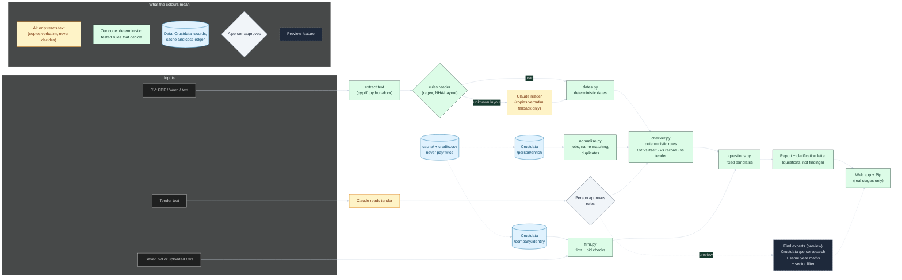

# TrueNorth: how it's built

Amber = AI (reads text only) · Green = our deterministic code (decides) · Blue = data · Grey = a person approves · Dashed = preview.

CVs in the standard NHAI layout are read by rules with no AI; Claude reads only unfamiliar layouts, copying text verbatim. Every decision is made by tested, deterministic code.
